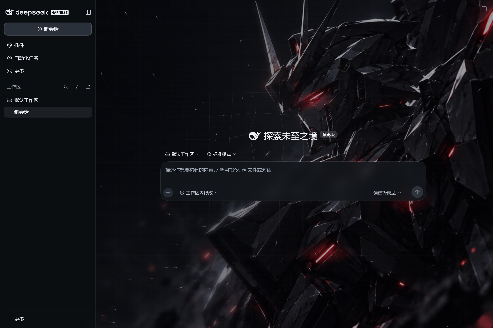
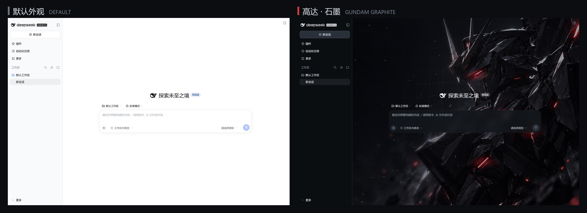
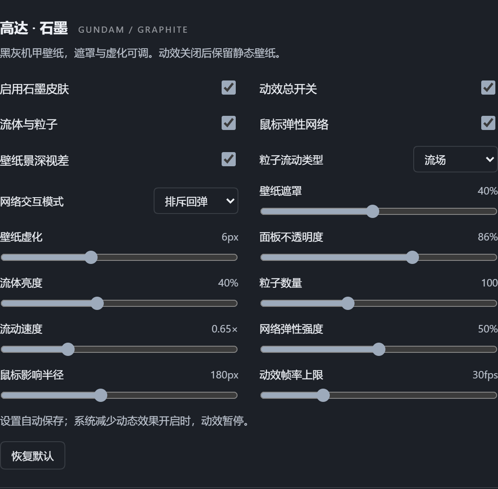

# Gundam Graphite for DeepSeek Harness

A low-key graphite theme for DeepSeek Harness: a dark mecha wallpaper behind translucent graphite panels, drifting silver particles, and a spring mesh that follows the pointer.



*Left: default UI. Right: the same page with the theme enabled (1440×960).*



## Features

- **Wallpaper and shading** — bundled 1672×941 dark mecha artwork, cover-cropped; wallpaper dim 0–85% and blur 0–16px are adjustable.
- **Depth parallax** — far haze and near mech move in opposite directions with the pointer (up to ~6px relative shift), separately switchable.
- **Graphite glass panels** — sidebar, composer and dialogs share a translucent graphite surface, opacity 60–100%.
- **Fluid particles** — flow / vortex / shower modes; brightness, count (20–240) and speed (0.15–2×) adjustable.
- **Elastic mesh** — nodes are pushed or pulled by the pointer and spring back; five modes (repel, attract, ripple, swirl, pulse), radius 80–320px. Disabled on touch devices.
- **Fully reversible** — turning off “Enable graphite skin” restores the native look; your light/dark preference is never overwritten.
- **Durable settings** — persisted through the DSH host settings store, not localStorage.
- **Light on resources** — 30fps default cap, pauses when the page is hidden, respects `prefers-reduced-motion`.

## Install

```sh
# from a GitHub release tarball (works offline)
dsh plugin add ./dsh-gundam-graphite-theme.tgz

# or straight from the repository (pnpm may ask to allow the git dependency's build)
dsh plugin add github:machi12/dsh-gundam-graphite-theme
```

Or install it from the plugin market’s **Themes** tab. Add `--profile <name>` to target a specific profile. Restart DSH afterwards, then open **Settings → General → 高达 · 石墨**.

## Screenshots



## Settings

16 live controls, all saved automatically: enable skin, motion master switch, fluid/particles, pointer mesh, parallax, particle mode, mesh mode, wallpaper dim, wallpaper blur, surface opacity, fluid brightness, particle count, flow speed, mesh strength, pointer radius, fps cap.

## Compatibility

- Requires DeepSeek Harness **0.2.0-rc.2 or newer** (`engines.dsh >= 0.2.0-rc.2`).
- A client plugin (`platform: web`) shared by the desktop and web builds — no Electron preload injection, no `app.asar` patching.
- Verified for settings persistence, independent toggles, host layout geometry, narrow windows, reduced motion, and restoring the original light preference.

## Build

```sh
npm install
npm run check
npm pack
```

## License

Code is MIT-licensed; see [LICENSE](LICENSE). The bundled wallpaper is **not** covered by MIT — see [THIRD_PARTY_NOTICES.md](THIRD_PARTY_NOTICES.md).
