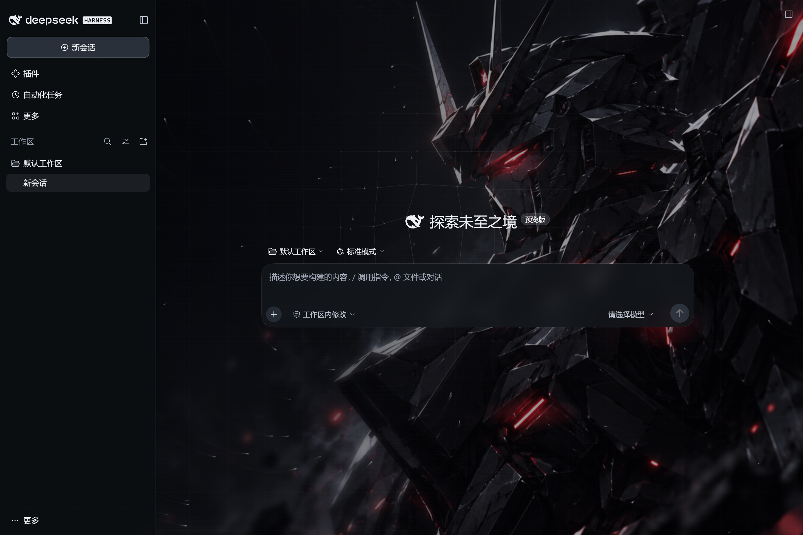
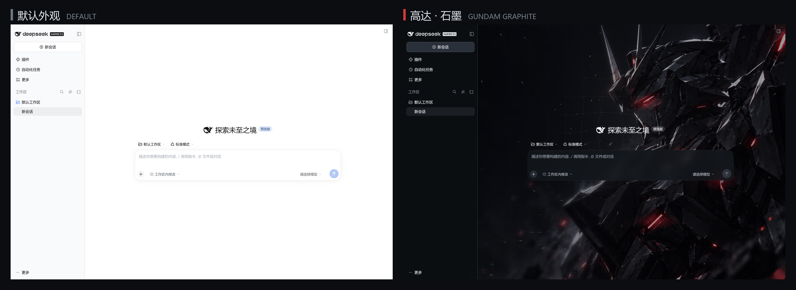
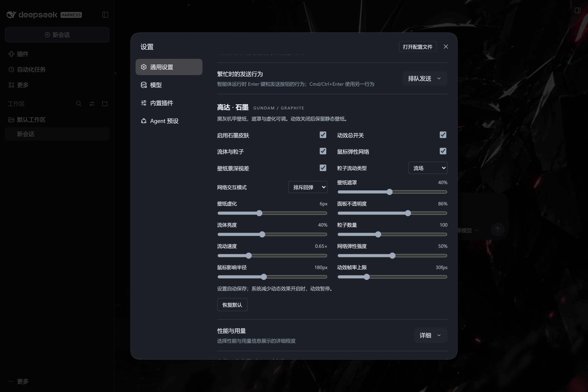
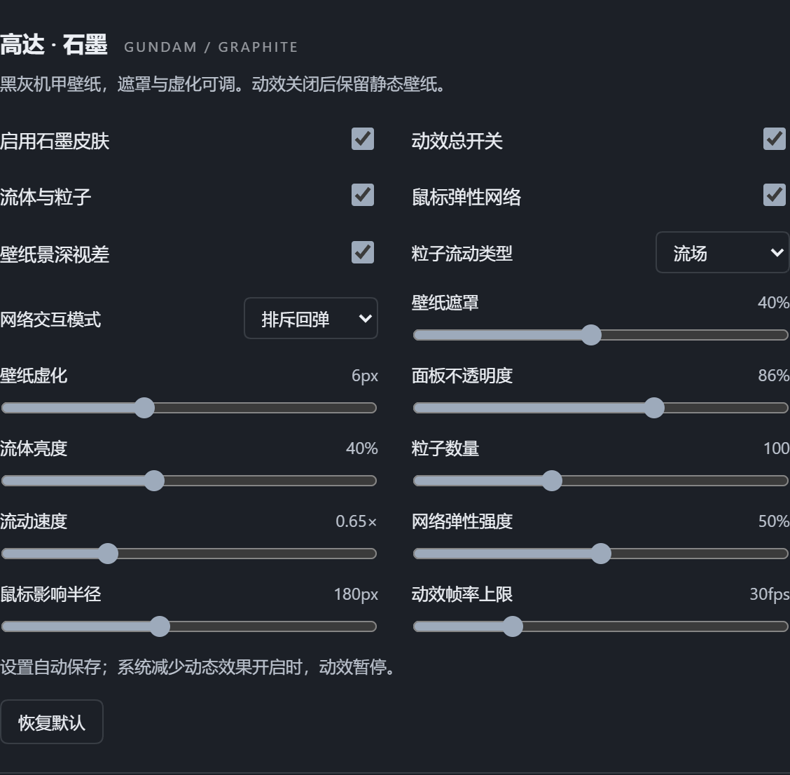
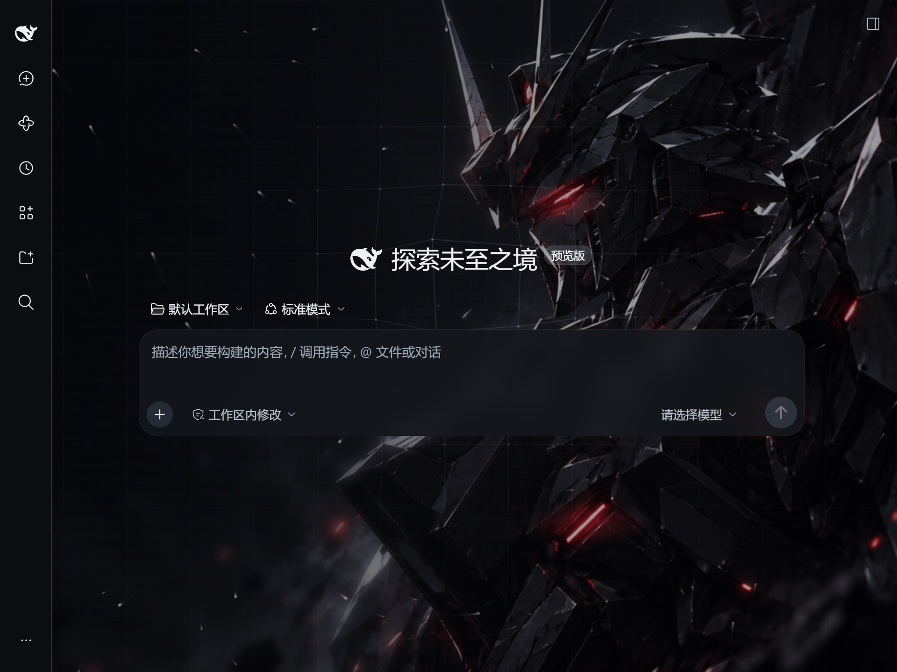

# 高达 · 石墨 / Gundam Graphite

DeepSeek Harness 的黑灰机甲主题皮肤：内置黑灰高达壁纸，把侧栏、输入框和弹窗统一成石墨玻璃面板，背景里流动着银灰粒子与一层会被鼠标牵动的弹性网格。



> 左边是默认界面，右边是启用主题后的同一个页面（1440×960）：
>
> 

不想用了？设置里关掉「启用石墨皮肤」即可回到原生外观，原外观偏好（浅色 / 深色）不会被改写。

## 目录

- [实际效果](#实际效果)
- [功能](#功能)
- [安装](#安装)
- [卸载](#卸载)
- [设置项](#设置项)
- [性能与无障碍](#性能与无障碍)
- [兼容性](#兼容性)
- [常见问题](#常见问题)
- [从源码构建](#从源码构建)
- [授权与素材声明](#授权与素材声明)

## 实际效果

主界面：壁纸左侧压暗、右侧渐显，正文区域始终可读。


设置里的主题面板（DSH → 设置 → 通用设置 → 高达 · 石墨），16 项全部实时生效、自动保存：



主题面板近景：



窄窗口（960×720）下壁纸与面板按比例适配，不会出现横向滚动：



## 功能

- **壁纸与遮罩**：内置 1672×941 黑灰机甲图，按窗口比例裁切。壁纸遮罩 0–85%、虚化 0–16px 可调，用来平衡氛围与文字可读性。
- **景深视差**：鼠标移动时，远景烟尘与近景机体反向位移，相对位移最多约 6px（独立开关）。
- **红光呼吸与火星**：眼部与两处装甲灯条缓慢呼吸；流体开启时，灯光附近偶尔飘出少量暗红火星。
- **石墨玻璃面板**：侧栏、输入卡、设置弹窗等宿主面板统一为半透明石墨色，不透明度 60–100% 可调。
- **流体粒子**：流场、涡旋、星雨三种流动轨迹；亮度、数量（20–240）、速度（0.15–2×）可调。
- **鼠标弹性网络**：节点被鼠标推开或拉近后阻尼回弹，提供排斥回弹、吸引回弹、涟漪扩散、旋涡扭转、呼吸脉冲五种模式；影响半径 80–320px、强度 0–100% 可调。触摸设备自动关闭。
- **完全可关**：关闭「启用石墨皮肤」立即恢复宿主原生外观，不需要卸载；主题启用期间临时使用深色呈现，不改写你的外观偏好。
- **省电**：动效帧率上限 20–60fps（默认 30），页面隐藏 / 最小化时暂停，系统开启「减少动态效果」时自动停止动效。
- **设置持久化**：通过 DSH 宿主设置保存，重启后保留，不依赖 localStorage。

## 安装

### 方式一：插件市场（推荐）

DSH 插件市场 → 分类「主题」→「高达 · 石墨」→ 安装，然后重启应用。装好后在 **设置 → 通用设置 → 高达 · 石墨** 里调整效果。

### 方式二：命令行

```sh
# 从 GitHub 安装
dsh plugin add github:machi12/dsh-gundam-graphite-theme

# 或从本地 tarball 安装
dsh plugin add ./dsh-gundam-graphite-theme.tgz

# 或从本地目录安装
dsh plugin add ./dsh-gundam-graphite-theme
```

安装到指定配置时加 `--profile <name>`，例如桌面版：

```powershell
# 使用 DSH 桌面版自带的 CLI（路径以本机安装目录为准）
& 'D:\dsh\resources\runtime\cli\bin\dsh.cmd' plugin --profile desktop add github:machi12/dsh-gundam-graphite-theme
```

首次安装需要包管理器能下载 `@deepseek-ai/schemastery` 依赖；壁纸与动效均已内嵌在包内，不访问外部图片服务。

装完请**完全退出并重新打开** DSH（桌面版直接关窗口通常只是隐藏到托盘）。Web 版刷新页面即可。

## 卸载

```sh
dsh plugin remove dsh-gundam-graphite-theme
```

也可以在 DSH 的插件管理界面停用或卸载。只想去掉壁纸效果而不卸载，关闭「启用石墨皮肤」即可。

## 设置项

| 设置 | 默认 | 范围 / 选项 | 作用 |
| --- | --- | --- | --- |
| 启用石墨皮肤 | 开 | 开 / 关 | 总开关，关闭后恢复宿主原生外观 |
| 动效总开关 | 开 | 开 / 关 | 关闭后保留静态壁纸，停止粒子、网络、呼吸与视差 |
| 流体与粒子 | 开 | 开 / 关 | 银灰雾光与流动粒子 |
| 鼠标弹性网络 | 开 | 开 / 关 | 鼠标附近的网格节点受力偏移，离开后回弹 |
| 壁纸景深视差 | 开 | 开 / 关 | 鼠标移动时远景与近景的反向位移 |
| 粒子流动类型 | 流场 | 流场 / 涡旋 / 星雨 | 粒子运动轨迹 |
| 网络交互模式 | 排斥回弹 | 排斥回弹 / 吸引回弹 / 涟漪扩散 / 旋涡扭转 / 呼吸脉冲 | 网格节点的受力方式 |
| 壁纸遮罩 | 40% | 0–85% | 压暗壁纸，提高数值可提升正文对比度 |
| 壁纸虚化 | 6px | 0–16px | 减少壁纸细节对阅读的干扰 |
| 面板不透明度 | 86% | 60–100% | 石墨面板的不透明度 |
| 流体亮度 | 40% | 0–100% | 雾光与粒子的亮度 |
| 粒子数量 | 100 | 20–240 | 按窗口面积适配，桌面端设上限 |
| 流动速度 | 0.65× | 0.15–2× | 粒子与雾光的流动速度 |
| 网络弹性强度 | 50% | 0–100% | 节点受力偏移的幅度 |
| 鼠标影响半径 | 180px | 80–320px | 鼠标影响网格节点的范围 |
| 动效帧率上限 | 30fps | 20–60fps | 实际帧率取决于设备性能 |

所有设置自动保存；宿主未连接时控件显示为不可用。

## 性能与无障碍

- 默认 30fps 上限、100 个粒子、最多约 600 个网格节点，Canvas 分辨率倍率上限 1.5。
- 页面隐藏、窗口失焦或系统开启「减少动态效果」时暂停动画并清除画布。
- 背景图层不拦截鼠标事件，也不进入辅助技术焦点（`aria-hidden`）。
- 触摸设备自动关闭鼠标弹性网络（`pointer: coarse`）。

## 兼容性

- 需要 DeepSeek Harness **0.2.0-rc.2 及以上**（`engines.dsh >= 0.2.0-rc.2`）。
- 属于客户端插件（`platform: web`）：桌面版与 Web 版共用同一套客户端插件机制，不是 Electron 预加载注入，不修改 `app.asar`。
- 已验证：设置保存与重启恢复、各开关独立生效、主容器尺寸不变、侧栏交互、窄窗口无横向溢出、减少动态效果、浅色偏好恢复。
- 不在修改范围：Electron 原生窗口边框、第三方插件自绘面板。DSH 后续大版本若调整主题变量或会话容器结构，可能需要适配。

## 常见问题

**装完没有变化？** 确认已完全退出并重启 DSH；Web 版刷新页面。插件管理里刚启用时也需要重新加载页面。

**壁纸太亮 / 太暗？** 调「壁纸遮罩」与「面板不透明度」；也可以加一点「壁纸虚化」让正文更清楚。

**只要壁纸，不要动效？** 关闭「动效总开关」，壁纸保留，粒子、网络、呼吸与视差全部停止。

**和浅色主题冲突吗？** 不冲突。主题启用期间临时以深色呈现，关闭后恢复你原本的浅色 / 深色偏好。

**支持触屏 / 平板吗？** 支持，壁纸与流体粒子可用；鼠标弹性网络在触摸设备上自动关闭。

## 从源码构建

```sh
npm install
npm run check   # 构建 + 单元测试
npm pack        # 生成可安装的 .tgz
```

`src/client/` 是界面、样式与动效，`src/config.js` 是设置定义，`lib/` 是已构建的交付产物，`tests/` 是单元测试。`assets/wallpaper.png` 在构建时内嵌进客户端包，避免自定义协议下的资源路径问题。

设置传输部分参考了 [JohnnyTing/dsh-official-homepage-theme](https://github.com/JohnnyTing/dsh-official-homepage-theme)，详见 `THIRD_PARTY_NOTICES.md`。

## 授权与素材声明

代码以 MIT 授权发布，见 [LICENSE](LICENSE)。

壁纸来自作者本人提供的图片，**不包含在 MIT 授权范围内**；本仓库不声称拥有该图片或高达相关角色的版权，对外分发与商用前请自行确认图片授权。完整说明见 [THIRD_PARTY_NOTICES.md](THIRD_PARTY_NOTICES.md)。
